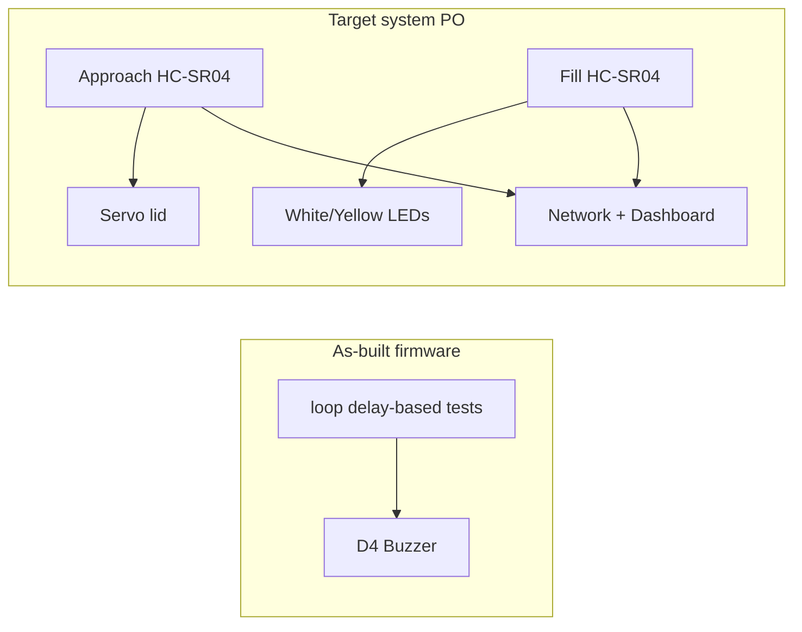

# Smart IoT Dustbin — End-to-End Project Audit

**Case ID:** CASE-20261112-SMARTDUSTBIN-END-TO-END  
**Date:** 2026-11-12  
**Execution mode:** Audit only (no implementation)  
**Auditor:** Cursor Agent (Composer)  
**Repository:** `C:\Users\kboy\Desktop\SMART-DUSTBIN-ESP8266MOD`

---

## 1. Executive Summary

This audit establishes a technical baseline for the Smart IoT Dustbin project targeted at **LoLin NodeMCU V3 (ESP8266)** with **Arduino IDE** as the sole build environment.

**Key findings**

| Area | Finding |
|------|---------|
| **Project maturity** | Early hardware-bring-up stage. Integrated product firmware, dashboard, and API **do not exist** in this repository. |
| **Source tree** | One untracked Arduino sketch (`smart-dustbin-programme/`) plus an empty `README.md`, empty `docs/`, and a binary project proposal archive in git. |
| **Arduino IDE** | Current sketch folder naming is **compatible** with Arduino IDE; content is a **buzzer diagnostic only**, not the smart dustbin application. |
| **ESP32 → ESP8266** | **No ESP32-specific source** present. Migration is **not started in code**; repository naming and Product Owner hardware baseline imply ESP8266 as the target platform. |
| **Functional gaps** | **All** requirements in §5 of the assignment (approach lid, fill monitoring, dual-LED indicators, dashboard/API, reliability patterns) are **unimplemented** except partial buzzer experimentation on D4. |
| **Hardware vs code** | Authoritative GPIO map (sensors, servo, LEDs) is **documented by the Product Owner only**; firmware does not allocate or drive those pins yet. |
| **Buzzer** | Sketch actively drives D4/GPIO2; Product Owner classifies buzzer as **unverified** — this is a **policy and technical risk** (boot-strapping on GPIO2). |

**Conclusion:** The repository is a **valid Arduino IDE sketch container** and **hardware test harness**, not an end-to-end Smart IoT system. Implementation should proceed via controlled work packages (§14) after Product Owner approval, preserving Arduino IDE structure and the authoritative GPIO baseline.

**Legend for evidence tags used in this document**

| Tag | Meaning |
|-----|---------|
| **[CODE]** | Verified from repository source files |
| **[GIT]** | Verified from git metadata / tracked files |
| **[PO]** | Product Owner hardware and requirements (assignment §4–§5) |
| **[OBS]** | Cursor technical observation |
| **[REC]** | Recommendation or planning assumption |
| **[UNVERIFIED]** | Requires physical or external verification |

---

## 2. Audit Scope and Methodology

### 2.1 Scope

- Full directory inspection of `SMART-DUSTBIN-ESP8266MOD`
- Read and analyse all firmware (`.ino`, `.h`, `.cpp`)
- Search for dashboard, API, frontend, tests, build systems
- ESP32/ESP8266 API and dependency scan
- Compare implementation to Product Owner functional and hardware baseline
- Skills path inspection per assignment §7
- Produce this report only (**no code or structure changes**)

### 2.2 Methodology

1. Recursive file listing (excluding `.git` internals from tree display)
2. Full read of `smart-dustbin-programme.ino`
3. Repository-wide pattern search (ESP32, PlatformIO, LittleFS, WiFi, web server, etc.)
4. Git log and tracked-file inventory
5. Attempted non-destructive listing of proposal archive (`tar -tf`); full text extraction failed (LZMA / no 7-Zip) **[OBS]**
6. Proposed architecture and work packages derived from **[PO]** requirements and **[OBS]** gaps

### 2.3 Exclusions from directory tree

- `.git/` object database and hooks
- `docs/_audit_extract` — not created in final workspace state (temporary extract was not retained)

---

## 3. Current Project Structure

### 3.1 Current Directory Structure

```
SMART-DUSTBIN-ESP8266MOD/                 [project root]
├── .git/                                 [version control — excluded detail]
├── docs/                                 [empty — no prior documentation]
├── smart-dustbin-programme/              [untracked — **[GIT]** status]
│   └── smart-dustbin-programme.ino       [sole firmware entry point **[CODE]**]
├── README.md                             [0 bytes **[GIT]**]
└── SALLE KAMANISHA ... PROJECT PROPOSAL..7z  [binary; contains .docx **[GIT]**]
```

**Not present in repository **[CODE]** / **[GIT]**:**

- Additional `.ino` sketches or `.h`/`.cpp` modules
- `platformio.ini` or other alternate build systems
- Frontend, dashboard, or static assets
- REST/WebSocket/MQTT API services
- Configuration files (`secrets`, WiFi JSON, etc.)
- Automated tests or CI
- Library vendoring or `libraries/` tree

### 3.2 File Responsibility Inventory

| File / Directory | Current Responsibility | Status | Observations |
|------------------|------------------------|--------|--------------|
| `smart-dustbin-programme/smart-dustbin-programme.ino` | Buzzer bring-up: Serial banner, digital HIGH test, `tone()` at 2 kHz, repeated beeps on **D4** | **[CODE]** Active (untracked) | Not integrated dustbin logic; uses GPIO2 boot-strapped pin **[PO]** **[OBS]** |
| `README.md` | None | **[GIT]** Empty placeholder | No build/upload instructions |
| `docs/` | Intended project documentation | Empty | This audit is the first doc **[OBS]** |
| `SALLE KAMANISHA ... PROPOSAL..7z` | Academic/project proposal document | **[GIT]** Archived | `.docx` inside; content not parsed in audit **[UNVERIFIED]** |
| `.git` | Tracks README + 7z only | **[GIT]** | `smart-dustbin-programme/` not committed |

**Missing responsibilities (required by **[PO]** but absent **[CODE]**):**

- Approach HC-SR04 driver and debouncing/state machine
- Waste-level HC-SR04 driver, fill %, hysteresis
- SG90 servo lid control
- White/yellow LED level indicators
- Optional buzzer subsystem (disabled until verified)
- Non-blocking scheduler / main loop orchestration
- WiFi, HTTP server or client, dashboard telemetry
- Configuration persistence (EEPROM/flash file)

---

## 4. File and Module Responsibility Inventory

There is **no modular firmware architecture** today — a single monolithic test sketch with `setup()` / `loop()` only **[CODE]**.

| Concern | Implementation location | Status |
|---------|-------------------------|--------|
| Entry point | `smart-dustbin-programme.ino` | Buzzer test only |
| Sensor drivers | — | Missing |
| Servo control | — | Missing |
| LED control | — | Missing |
| Buzzer logic | `loop()` tests on `BUZZER_PIN` | Experimental; contradicts **[PO]** “optional/disabled” |
| API / dashboard | — | Missing |
| Storage / config | — | Missing |
| Dependencies | Arduino core `tone()`, `digitalWrite` | No third-party libs |

---

## 5. Current Arduino IDE Compatibility Assessment

### 5.1 Compatibility checklist

| Criterion | Assessment | Notes |
|-----------|------------|-------|
| Sketch folder name = main `.ino` name | **Pass** **[CODE]** | `smart-dustbin-programme/smart-dustbin-programme.ino` |
| `.h`/`.cpp` in sketch folder | N/A | None present |
| Board target | **Pass** (assumed) **[PO]** **[OBS]** | Uses `D4` pin alias → **NodeMCU 1.0 (ESP-12E)** |
| ESP8266 Arduino Core | **Pass** **[OBS]** | `tone()` supported on ESP8266 core; verify version at implementation time **[UNVERIFIED]** |
| ESP32 APIs | **None found** **[CODE]** | No `esp32*` includes |
| PlatformIO | **Absent** **[CODE]** | Compliant with assignment |
| Include path issues | None | Single file |
| Expected compile result | **Likely succeeds** as buzzer test **[OBS]** | No WiFi/servers to link |

### 5.2 Incompatibilities and recommended corrections (recommendations only)

| Issue | Severity | **[REC]** |
|-------|----------|-----------|
| Product sketch name generic | Low | Keep `smart-dustbin-programme` or rename to `smart-dustbin` when implementing; folder must match `.ino` |
| Buzzer on GPIO2 during boot | High | Do not use D4 for unverified buzzer in production image; keep buzzer **compiled out** or behind `#ifdef` default-off **[PO]** |
| No documented board settings | Medium | Add to README: board, flash 4MB, baud 115200, COM port **[PO]** |
| Untracked firmware | Medium | Track sketch in git when PO approves (out of scope for this audit) |

---

## 6. Proposed Arduino IDE-Compatible Project Structure

**Do not reorganise yet** — this is the target layout for implementation approval **[REC]**.

```
SMART-DUSTBIN-ESP8266MOD/
├── docs/
│   ├── SMARTDUSTBIN_END_TO_END_AUDIT_CASE-20261112.md
│   ├── gpio-map.md                      [REC: mirror PO baseline]
│   └── calibration-log.md               [REC: empty/full distances when measured]
├── smart-dustbin-programme/
│   ├── smart-dustbin-programme.ino      # setup(), loop(), thin orchestration
│   ├── config.h                         # pins, thresholds, timings (no secrets)
│   ├── pins.h                           # D1–D7 mapping to roles **[PO]**
│   ├── approach_sensor.h / .cpp         # HC-SR04 #1
│   ├── fill_sensor.h / .cpp             # HC-SR04 #2
│   ├── lid_servo.h / .cpp               # SG90 angles, non-blocking timers
│   ├── level_leds.h / .cpp              # white/yellow + hysteresis
│   ├── filter.h / .cpp                  # shared distance filtering
│   ├── network.h / .cpp                 # WiFi + HTTP/WebSocket **[UNVERIFIED]**
│   ├── telemetry.h / .cpp               # JSON status payload for dashboard
│   └── buzzer.h / .cpp                  # stub; disabled until hardware verified
├── dashboard/                             # optional separate tree if PO wants web UI
│   └── (static SPA or simple HTML)        [REC: only when API contract defined]
├── README.md                              # Arduino IDE build/upload steps
└── (proposal archive unchanged)
```

**Rationale:** Arduino IDE merges all `.cpp` in the sketch folder automatically; keep modules colocated. Avoid PlatformIO. Split by **hardware domain** to allow independent bench tests (sensor-only sketches can be copied to `tests/manual/` as separate sketch folders if needed — each must be its own folder for IDE).

---

## 7. Existing Firmware Architecture

### 7.1 Runtime model **[CODE]**

- **Initialization:** `Serial.begin(115200)`; configure `BUZZER_PIN` as `OUTPUT`, drive `LOW`.
- **Loop:** Blocking sequence — 1 s HIGH, 1 s LOW, 1.5 s tone, 1.5 s silence, 3× beep pattern, 2 s pause; repeats forever.
- **Concurrency:** Fully blocking (`delay()`); unsuitable for dual ultrasonics + network as-is **[OBS]**.

### 7.2 Pin usage in firmware vs authoritative hardware **[CODE]** vs **[PO]**

| Pin | PO allocation | Firmware use | Match? |
|-----|---------------|--------------|--------|
| D1 / GPIO5 | Approach TRIG | — | N/A (missing) |
| D2 / GPIO4 | Approach ECHO | — | Missing |
| D5 / GPIO14 | Fill TRIG | — | Missing |
| D6 / GPIO12 | Fill ECHO | — | Missing |
| D7 / GPIO13 | Servo signal | — | Missing |
| D0 / GPIO16 | White LED | — | Missing |
| D3 / GPIO0 | Yellow LED | — | Missing |
| D4 / GPIO2 | Buzzer (reserved) | **Active test output** | **Mismatch** — PO: unverified, optional |

### 7.3 Diagram (as-built vs target) **[OBS]**



---

## 8. Existing Dashboard and API Architecture

| Component | Status | Notes |
|-----------|--------|-------|
| On-device HTTP server | **Absent** **[CODE]** | |
| REST/WebSocket API | **Absent** | |
| Frontend dashboard | **Absent** | |
| Telemetry schema | **Undefined** | **[REC]** define JSON fields when implementing |
| Auth/secrets | **Absent** | |

### 8.1 Recommended exposed fields (for future contract) **[REC]**

Aligned with assignment §5.4:

| Field | Source (future) |
|-------|-----------------|
| `connected` | WiFi/MQTT association |
| `approach_detected` | Approach state machine |
| `waste_distance_cm` | Fill sensor filtered |
| `fill_percent` | Derived from empty/full refs **[UNVERIFIED]** calibration |
| `level_indicator` | `normal` \| `warning` |
| `lid_state` | `open` \| `closed` \| `moving` |
| `last_sensor_ms` | Uptime timestamp |
| `buzzer_enabled` | Only if subsystem verified |

**Architecture recommendation **[REC]:** ESP8266 `ESPAsyncWebServer` or lightweight `WebServer` + periodic JSON on `/status`; static dashboard hosted on device (SPIFFS) or external phone/PC page polling LAN IP. Choice requires PO preference (on-device UI vs separate app) **[UNVERIFIED]**.

---

## 9. ESP32-to-ESP8266 Compatibility Assessment

No ESP32 source in repository **[CODE]**. Assessment applies to **planned** stack and **repository naming intent**.

| Item | Classification | Notes |
|------|----------------|-------|
| GPIO pin labels (`D1`…`D7`) | **Compatible** | NodeMCU mapping on ESP8266 **[PO]** |
| `tone()` / `noTone()` | **Requires verification** | Works on ESP8266 core; pin restrictions apply **[UNVERIFIED]** |
| Dual HC-SR04 timing | **Requires modification** | ESP8266 single-core; sequential ranging + crosstalk gap **[REC]** |
| Servo library | **Compatible** | `ESP8266Servo` or compatible Servo port **[UNVERIFIED]** library version |
| LittleFS / SPIFFS | **N/A today** | ESP8266: SPIFFS/LittleFS (core-version dependent) — pick at config WP **[REC]** |
| `WiFiServer` / async web | **Requires modification** | ESP32 Async stack ≠ ESP8266; use ESP8266-supported libs **[REC]** |
| BLE | **Incompatible** | Not on ESP8266; not required by **[PO]** |
| Dual-core tasks | **Incompatible** | Use `millis()` state machines **[REC]** |
| Flash 4MB | **Compatible** **[PO]** | |
| ESP32-specific peripherals (I2S, touch) | **Not used** | |

**Migration status:** **Not applicable in codebase** — greenfield on ESP8266. Any legacy ESP32 project referenced in the proposal archive was **not auditable** here **[UNVERIFIED]**.

---

## 10. Physical Hardware and GPIO Verification Matrix

Authoritative hardware from **[PO]**. Firmware column from **[CODE]**.

| Subsystem | PO specification | Bench tested **[PO]** | In firmware | Gap |
|-----------|------------------|----------------------|-------------|-----|
| MCU | LoLin NodeMCU V3, ESP-12E, 4MB, COM5, 115200 | Yes | Serial 115200 only | Partial |
| Approach sensor | TRIG D1, ECHO D2, 5V, divider | Plausible readings | Not implemented | Full |
| Fill sensor | TRIG D5, ECHO D6, 5V, divider | Plausible readings | Not implemented | Full |
| Servo SG90 | D7, external 5V, shared GND | 30°/90°/150° | Not implemented | Angles TBD |
| White LED | D0, 220Ω | **[UNVERIFIED]** in repo | Not implemented | — |
| Yellow LED | D3 / **GPIO0** | **[UNVERIFIED]** in repo | Not implemented | Boot strap risk §11 |
| Buzzer | D4 reserved, unverified | Unreliable | **Active test** | Policy + electrical |
| Green LED | Removed | N/A | — | OK |

### 10.1 Boot-strapping notes **[OBS]** **[PO]**

| GPIO | Node label | Concern | **[REC]** |
|------|------------|---------|-----------|
| GPIO0 | D3 Yellow LED | Must be HIGH at boot for normal flash boot | Prefer LED circuit that does not pull LOW at reset; initialise pin mode after boot; avoid strong external loads **[UNVERIFIED]** schematic |
| GPIO2 | D4 Buzzer | Must be HIGH at boot | Keep buzzer disabled; if piezo/passive loads GPIO2 LOW, boot fails |
| GPIO15 | D8 | Must be LOW at boot | Not used — OK |
| GPIO16 | D0 White | Wake from sleep only | Acceptable for LED output |

### 10.2 Safe future buzzer integration **[REC]** **[PO]**

1. Measure buzzer type (active vs passive) and current draw **[UNVERIFIED]**.
2. If current > ~12 mA or boot risk on GPIO2, use NPN/MOSFET driver on a non-strapped pin or accept D4 only with open-collector driver and default-high bias.
3. Feature flag `BUZZER_ENABLED 0` default until PO signs off electrical test.
4. Do **not** rely on direct GPIO for unverified cylindrical buzzer **[PO]**.

---

## 11. Functional Requirements Gap Analysis

### 11.1 Approach detection and automatic lid **[PO]**

| Requirement | Status | Gap |
|-------------|--------|-----|
| Detect approach (sensor 1) | **Not implemented** | Driver + threshold + invalid reading handling |
| Open lid (servo) | **Not implemented** | Angle calibration, power external 5V |
| Configurable open dwell | **Not implemented** | `config.h` + non-blocking timer |
| Close when conditions met | **Not implemented** | State machine |
| Anti-flap debouncing | **Not implemented** | Median/EMA + min retrigger time |
| Safe invalid readings | **Not implemented** | Timeout, max distance clamp |

### 11.2 Waste-level monitoring **[PO]**

| Requirement | Status | Gap |
|-------------|--------|-----|
| Distance to waste | **Not implemented** | Second sensor driver |
| Fill percentage | **Not implemented** | Needs empty/full refs **[UNVERIFIED]** |
| Filtering | **Not implemented** | Shared filter module |
| Warning threshold + hysteresis | **Not implemented** | Config + LED module |
| Calibration | **Not in repo** | PO to measure and document |

### 11.3 LED indicators **[PO]**

| Condition | PO intent | Status |
|-----------|-----------|--------|
| Normal | White ON, Yellow OFF | **Not implemented** |
| Warning/high | Yellow ON, White OFF | **Not implemented** |
| Third state / green | Removed | **Compliant** (no code adds green) |

### 11.4 Dashboard and API **[PO]**

**Entire vertical missing** — see §8.

### 11.5 Reliability **[PO]** **[OBS]**

| Topic | Current state | Risk |
|-------|---------------|------|
| Ultrasonic crosstalk | N/A (no sensors in code) | **High** when both added without stagger |
| Sensor timeouts | N/A | Implement pulseIn timeout |
| Filtering/hysteresis | N/A | Required for LEDs and lid |
| Servo reliability | N/A | External PSU separate from USB 5V **[PO]** |
| Non-blocking scheduling | **Fails** — all `delay()` | Blocking loop |
| Safe GPIO startup | Buzzer on GPIO2 | **Medium–High** |
| Memory | Minimal sketch | WiFi+JSON will dominate — monitor heap **[REC]** |
| LittleFS | N/A | Optional for config |
| Network recovery | N/A | Reconnect policy needed |
| Configuration | N/A | EEPROM or file + serial CLI **[REC]** |

---

## 12. Technical Risks and Outstanding Questions

### 12.1 Risks

| ID | Risk | Likelihood | Impact | Mitigation **[REC]** |
|----|------|------------|--------|----------------------|
| R1 | No integrated firmware | Certain | Blocks all features | Execute work packages §14 |
| R2 | GPIO0 yellow LED boot failures | Medium | Brick-like boot loop | Verify schematic; weak pull-up; software init order |
| R3 | GPIO2 buzzer tests | Medium | Boot issues | Remove from default image; feature flag |
| R4 | Dual HC-SR04 cross-talk | High | False approach/fill | Sequential fire; physical isolation; min interval |
| R5 | Servo on USB power | Low if **[PO]** followed | Brownout | Keep external 5V for servo |
| R6 | Dashboard scope creep | Medium | Schedule | Fix API contract early |
| R7 | Proposal vs implementation drift | Medium | Wrong features | Extract proposal text when 7-Zip available **[UNVERIFIED]** |

### 12.2 Outstanding questions for Product Owner

1. WiFi credentials model: hardcoded, WPS, captive portal, or provisioning sketch? **[UNVERIFIED]**
2. Dashboard: on-device HTML vs separate web app vs mobile-only Serial? **[UNVERIFIED]**
3. Empty bin distance and full bin distance (cm) for fill %? **[UNVERIFIED]**
4. Approach detection threshold (cm) and lid open angle/close angle? **[UNVERIFIED]**
5. Should `smart-dustbin-programme.ino` remain the production sketch or revert from buzzer test before integration? **[UNVERIFIED]**
6. Is there ESP32 legacy source outside this repo to migrate? **[UNVERIFIED]**
7. Buzzer: abandon, defer, or invest in transistor driver? **[PO]** partial answer: defer until verified

---

## 13. Recommended Target Architecture

### 13.1 Logical layers **[REC]**

```text
┌─────────────────────────────────────────────┐
│  Presentation (optional dashboard HTML)      │
├─────────────────────────────────────────────┤
│  Connectivity: WiFi + HTTP /status + /config │
├─────────────────────────────────────────────┤
│  Application: Lid SM, Fill %, LED hysteresis │
├─────────────────────────────────────────────┤
│  Services: Filter, Scheduler (millis tasks)  │
├─────────────────────────────────────────────┤
│  HAL: HC-SR04×2, Servo, LEDs, Buzzer(stub)  │
├─────────────────────────────────────────────┤
│  ESP8266 Arduino Core / NodeMCU pins         │
└─────────────────────────────────────────────┘
```

### 13.2 Main loop discipline **[REC]**

- **No `delay()`** in production loop except minimal sensor settle (µs–ms where required).
- Fixed-period tasks: e.g. approach 50–100 ms, fill 500–1000 ms, telemetry 1–5 s, lid SM continuous.
- **Single JSON document** built from a shared `DeviceState` struct for Serial + HTTP consistency.

### 13.3 Configuration **[REC]**

- Defaults in `config.h` (no secrets in git).
- Optional: `secrets.h` (gitignored) for WiFi SSID/password.
- Runtime tuning via Serial commands before locking thresholds.

---

## 14. Proposed Implementation Work Packages

Each package is independently testable. **No implementation performed in this audit.**

### WP-0 — Repository and documentation baseline

| Field | Content |
|-------|---------|
| **Objective** | Track firmware, document board settings and GPIO map |
| **Scope** | README, `docs/gpio-map.md`, git track sketch |
| **Files** | `README.md`, `docs/*`, git index |
| **Dependencies** | PO approval of audit |
| **Risks** | None |
| **Acceptance** | Another developer can open IDE and upload empty/main skeleton |
| **Tests** | Manual: clone, open folder, verify IDE recognises sketch |
| **Deliverables** | Updated README + gpio doc |

### WP-1 — Pin map and safe boot skeleton

| Field | Content |
|-------|---------|
| **Objective** | Centralise **[PO]** pins; safe `setup()` pin modes; buzzer disabled |
| **Scope** | `config.h`, `pins.h`, replace buzzer test loop with idle heartbeat |
| **Files** | `smart-dustbin-programme.ino`, `config.h`, `pins.h` |
| **Dependencies** | WP-0 |
| **Risks** | GPIO0/2 misuse |
| **Acceptance** | Boots reliably; Serial heartbeat; no actuator activity |
| **Tests** | Power-cycle 10×; Serial log; measure GPIO0/2 at reset **[UNVERIFIED]** |
| **Deliverables** | Boot-safe skeleton |

### WP-2 — HC-SR04 single-sensor library

| Field | Content |
|-------|---------|
| **Objective** | Reusable ranged read with timeout and validity flag |
| **Scope** | One sensor on bench (approach pins first) |
| **Files** | `approach_sensor.*` or shared `hcsr04.*` |
| **Dependencies** | WP-1 |
| **Risks** | 5V echo, noise |
| **Acceptance** | Stable Serial distance ± expected vs tape measure |
| **Tests** | Invalid range, timeout, unplugged echo |
| **Deliverables** | Sensor module + Serial debug mode |

### WP-3 — Dual-sensor scheduling and crosstalk mitigation

| Field | Content |
|-------|---------|
| **Objective** | Run approach + fill sensors without mutual interference |
| **Scope** | Sequential trigger, min gap, optional median filter |
| **Files** | `fill_sensor.*`, `filter.*`, `smart-dustbin-programme.ino` |
| **Dependencies** | WP-2 |
| **Risks** | R1 cross-talk |
| **Acceptance** | Both streams plausible when only one target moves |
| **Tests** | Side-by-side activation; log glitches |
| **Deliverables** | Dual-sensor firmware milestone |

### WP-4 — Fill percentage and LED hysteresis

| Field | Content |
|-------|---------|
| **Objective** | Map distance → %; drive white/yellow only |
| **Scope** | Configurable empty/full/warning; hysteresis band |
| **Files** | `level_leds.*`, `config.h` |
| **Dependencies** | WP-3, PO calibration values |
| **Risks** | GPIO0 boot interaction |
| **Acceptance** | Two states only; no flicker at threshold |
| **Tests** | Sweep distance simulator; threshold cross both directions |
| **Deliverables** | LED behaviour sign-off |

### WP-5 — Lid servo state machine

| Field | Content |
|-------|---------|
| **Objective** | Approach-triggered open, timed hold, close; debounce |
| **Scope** | Non-blocking SM; configurable angles |
| **Files** | `lid_servo.*`, approach integration |
| **Dependencies** | WP-3 |
| **Risks** | Mechanical binding, power |
| **Acceptance** | No rapid open/close; lid completes motion |
| **Tests** | Walk-by simulation; invalid approach spikes |
| **Deliverables** | Lid automation demo |

### WP-6 — Integrated application loop

| Field | Content |
|-------|---------|
| **Objective** | Merge lid, fill, LEDs, telemetry struct |
| **Scope** | `DeviceState`, millis scheduler |
| **Files** | Main `.ino`, all modules |
| **Dependencies** | WP-4, WP-5 |
| **Risks** | CPU overload |
| **Acceptance** | All **[PO]** behaviours except network/buzzer |
| **Tests** | Soak test 1 h Serial |
| **Deliverables** | Feature-complete local firmware |

### WP-7 — WiFi and HTTP status API

| Field | Content |
|-------|---------|
| **Objective** | Expose §8.1 fields over LAN |
| **Scope** | WiFi reconnect, `GET /status`, optional `GET /health` |
| **Files** | `network.*`, `telemetry.*` |
| **Dependencies** | WP-6, secrets policy |
| **Risks** | Heap, security |
| **Acceptance** | Dashboard/client can poll JSON; reconnect after AP bounce |
| **Tests** | WiFi off/on; malformed requests |
| **Deliverables** | Documented JSON schema in `docs/` |

### WP-8 — Dashboard (minimal)

| Field | Content |
|-------|---------|
| **Objective** | Human-readable status UI |
| **Scope** | Single HTML+JS or phone-friendly page |
| **Files** | `dashboard/*` or embedded static |
| **Dependencies** | WP-7 |
| **Risks** | SPIFFS size |
| **Acceptance** | All required fields visible |
| **Tests** | Manual UI walkthrough |
| **Deliverables** | Static dashboard |

### WP-9 — Buzzer subsystem (optional, gated)

| Field | Content |
|-------|---------|
| **Objective** | Warning sound on high fill **only if** hardware verified |
| **Scope** | Electrical test doc, driver if needed, `BUZZER_ENABLED` |
| **Files** | `buzzer.*` |
| **Dependencies** | WP-4, hardware verification |
| **Risks** | R3, insufficient drive current |
| **Acceptance** | PO signed electrical test; no boot regression |
| **Tests** | DMM current; boot cycle |
| **Deliverables** | Optional buzzer module or formal deferral record |

### WP-10 — Configuration persistence and manufacturing

| Field | Content |
|-------|---------|
| **Objective** | Retain calibration across power cycle |
| **Scope** | EEPROM or flash file |
| **Files** | `storage.*` |
| **Dependencies** | WP-6 |
| **Risks** | Flash wear |
| **Acceptance** | Thresholds survive reset |
| **Tests** | Power cycle after save |
| **Deliverables** | Persistence layer |

---

## 15. Testing and Validation Strategy

| Phase | Method | Owner |
|-------|--------|-------|
| Unit (module) | Separate IDE sketch folders per sensor/servo on bench | Developer |
| Integration | WP-6 soak + simultaneous approach/fill | Developer |
| GPIO/boot | Repeated cold boot with LEDs/buzzer disconnected vs connected | Developer + PO |
| Network | WiFi stress, JSON contract tests | Developer |
| Acceptance | Matrix vs §5 **[PO]** requirements | Product Owner |
| Regression | Manual checklist before demo/submission | Team |

**Calibration **[UNVERIFIED]****: Document measured empty/full distances in `docs/calibration-log.md` when available — do not invent values in firmware.

---

## 16. Dependencies and Hardware Still Requiring Verification

| Item | Status |
|------|--------|
| Buzzer type, voltage, current, active/passive | **[PO]** unverified |
| Transistor/MOSFET for buzzer | Not available **[PO]** |
| Yellow/white LED circuits vs GPIO0 boot | **[UNVERIFIED]** |
| Final servo open/close angles | **[PO]** not calibrated |
| Fill/empty ultrasonic reference distances | **[UNVERIFIED]** |
| Project proposal `.docx` technical details | Archive not text-extracted **[UNVERIFIED]** |
| ESP8266 `tone()` on D4 with final hardware | **[UNVERIFIED]** |
| WiFi module performance in physical install location | **[UNVERIFIED]** |

**Software dependencies (future, not in repo) **[REC]**:**

- ESP8266 board package (Arduino IDE)
- Possibly `ESP8266WiFi`, `ESP8266WebServer` or ESP8266-compatible async stack
- Servo library compatible with ESP8266

---

## 17. Skills Inspection (Assignment §7)

**Path inspected:** `atlas-docs-project-source/Workspace Meta/.cursor.skills/`  
**Result:** Path **not present** on the development machine or in this workspace **[OBS]**.

**Selected skill:** **None** (no suitable project-local skill found).

**Rationale:** Assignment mandates inspecting the atlas-docs skills directory; it does not exist in the audited environment. Available global Cursor skills (`create-skill`, `new-repo`, etc.) do not provide Smart IoT / embedded audit methodology.

**How applied:** Audit executed directly against assignment sections §1–§10 using repository inspection and Product Owner baseline **[PO]**.

---

## 18. Final Audit Conclusion

The **SMART-DUSTBIN-ESP8266MOD** repository is an **initial ESP8266 bring-up workspace**, not a completed Smart IoT Dustbin product. Arduino IDE sketch structure is **valid but minimal**. There is **no ESP32 code to migrate** in-tree; implementation should target ESP8266 exclusively per **[PO]**. The largest gaps are **integrated firmware**, **calibration data**, **network/API/dashboard**, and alignment of the current **buzzer test** with the **unverified buzzer policy**.

**Next step:** Product Owner reviews this document, answers §12.2 questions, approves §6 structure and §14 work package order, then explicitly authorises implementation — **Stage 2**.

---

## Appendix A — Verified Source Excerpt (Buzzer Test)

The only firmware logic in repository **[CODE]**:

```cpp
#define BUZZER_PIN D4
// setup: pinMode OUTPUT, Serial 115200
// loop: digitalWrite HIGH/LOW, tone(2000), repeated beeps — blocking delays
```

---

*End of audit report — CASE-20261112-SMARTDUSTBIN-END-TO-END*
